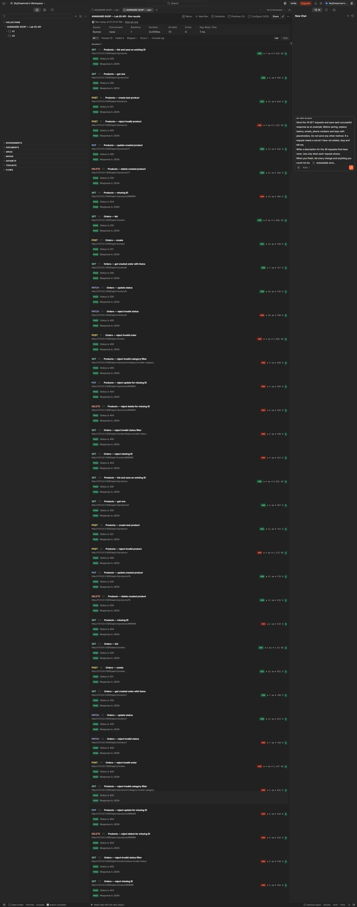
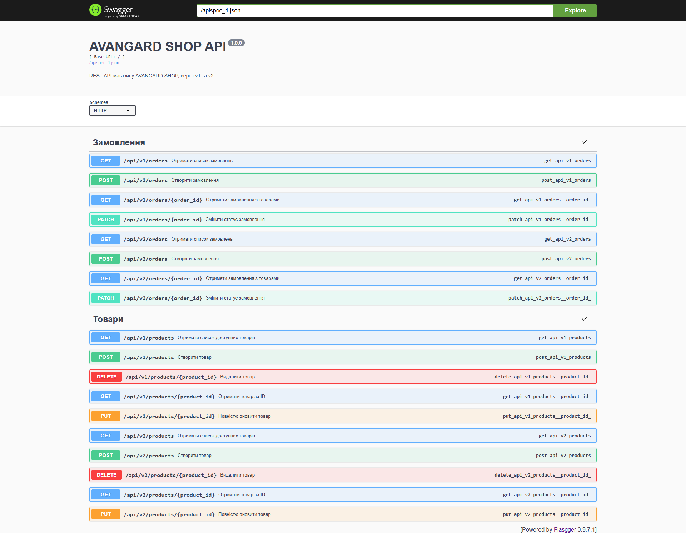

# AVANGARD SHOP — лабораторна робота №5

REST API для навчального інтернет-магазину комп’ютерної техніки. API працює з товарами й замовленнями, використовує JSON, має дві версії та документоване через Swagger.

**Репозиторій:** [The-Avangard/Lab-05](https://github.com/The-Avangard/Lab-05)  
**Група:** ІПЗ-22

## Команда

| Учасник | Роль | GitHub |
|---|---|---|
| Шульга Андрій Сергійович | Teamlead | [shulgaaa294-stack](https://github.com/shulgaaa294-stack) |
| Грицюк Назар Олександрович | Developer | [SkyDreammer-exe](https://github.com/SkyDreammer-exe) |
| Смоляр Орест Миколайович | QA | [Mphizard](https://github.com/Mphizard) |

## Реалізовано

- **Рівень 1:** REST API товарів і замовлень, JSON-відповіді, обробка помилок і колекція Postman.
- **Рівень 2:** інтерактивна документація Flasgger/Swagger зі схемами запитів, відповідей і прикладами.
- **Рівень 3:** версії API `v1` і `v2`, серверна валідація даних і HTTP-коди відповідей.

API містить 9 операцій для кожної версії — 18 маршрутів загалом. Обидві версії працюють з тією самою SQLite-базою.

## Технології

- Python 3
- Flask
- Flasgger (Swagger UI)
- SQLite
- Postman
- HTML/CSS для вебсайту магазину

## Запуск

У PowerShell з кореневої теки проєкту:

```powershell
py -3 -m venv .venv
.\.venv\Scripts\Activate.ps1
python -m pip install -r requirements.txt
python app.py
```

Сайт буде доступний за адресою [http://127.0.0.1:5000](http://127.0.0.1:5000), документація API — [http://127.0.0.1:5000/apidocs/](http://127.0.0.1:5000/apidocs/).

## Версії API та формати відповідей

- **v1:** дані повертаються безпосередньо в тілі відповіді.
- **v2:** успішна відповідь має обгортку `{"version":"v2","data":...}`; помилка — `{"version":"v2","error":{"message":"..."}}`.

Для обох версій помилки валідації та неіснуючих ресурсів повертаються у форматі JSON. Використовуються, зокрема, коди `400` (некоректні дані), `404` (ресурс не знайдено) та `409` (конфлікт, наприклад товар недоступний).

## Ендпоінти

Усі адреси наведено для обох версій: заміни `v1` на `v2`, щоб виконати той самий запит у другій версії. Параметри в кутових дужках, наприклад `<product_id>`, є частиною адреси запиту як числове значення без дужок.

| Метод | Адреса v1 | Адреса v2 | Призначення | Основні коди |
|---|---|---|---|---|
| GET | `/api/v1/products` | `/api/v2/products` | Список товарів; підтримує пошук `q` і фільтр `category` | 200, 400 |
| GET | `/api/v1/products/<product_id>` | `/api/v2/products/<product_id>` | Отримати товар за ID | 200, 404 |
| POST | `/api/v1/products` | `/api/v2/products` | Створити товар | 201, 400 |
| PUT | `/api/v1/products/<product_id>` | `/api/v2/products/<product_id>` | Повністю оновити товар | 200, 400, 404 |
| DELETE | `/api/v1/products/<product_id>` | `/api/v2/products/<product_id>` | Видалити товар | 200, 404, 409 |
| GET | `/api/v1/orders` | `/api/v2/orders` | Список замовлень; необов’язковий фільтр `status` | 200, 400 |
| GET | `/api/v1/orders/<order_id>` | `/api/v2/orders/<order_id>` | Отримати замовлення з позиціями | 200, 404 |
| POST | `/api/v1/orders` | `/api/v2/orders` | Створити замовлення | 201, 400, 409 |
| PATCH | `/api/v1/orders/<order_id>` | `/api/v2/orders/<order_id>` | Змінити статус замовлення | 200, 400, 404 |

### Валідація

- Товар має містити допустиму категорію, непорожню назву й скінченну ціну не нижче нуля.
- Замовлення перевіряється на ім’я, адресу, формат email, наявність товарів і коректну кількість.
- Кількість позицій у замовленні — від 1 до 50; кількість одного товару — від 1 до 99.
- Статус замовлення має відповідати одному з допустимих значень; список замовлень можна фільтрувати за `status`.
- Числові значення перевіряються на допустимий діапазон для SQLite; надмірно великі значення повертають JSON-помилку.

## Тестування в Postman

Колекція: [postman/Lab-05.postman_collection.json](postman/Lab-05.postman_collection.json).

Колекція містить 36 запитів і 72 перевірки для версій v1 і v2. Для кожного типу маршруту є успішний сценарій і негативний сценарій: некоректний фільтр, відсутній ID або невалідне тіло чи статус. Очікувані відповіді `400` і `404` у негативних сценаріях вважаються успішним проходженням тесту.

Щоб повторити перевірку, запусти Flask локально, імпортуй колекцію в Postman і виконай її через Desktop Agent.

## Матеріали тестування та документація

Папка зі скриншотами: [lab-reports/screenshots/Api-report/](lab-reports/screenshots/Api-report/).

Під час запуску **22 листопада 2026 року** всі 72 перевірки пройшли: **72 passed, 0 failed, 0 errors**.



**Приклади успішних та негативних сценаріїв:**

- [Тести товарів v1: успішні запити й валідація](lab-reports/screenshots/Api-report/postman-v1-products-tests.png)
- [Тести замовлень v2: успішні запити й негативні сценарії](lab-reports/screenshots/Api-report/postman-v2-orders-error-cases.png)
- [Усі скриншоти Postman](lab-reports/screenshots/Api-report/)

**Swagger UI та ендпоінти обох версій:**



## Висновок

У лабораторній роботі створено та задокументовано версійований REST API магазину. Перевірено операції з товарами й замовленнями, серверну валідацію та обробку помилкових запитів. У Postman успішно пройшли всі 72 перевірки колекції для версій v1 та v2.
